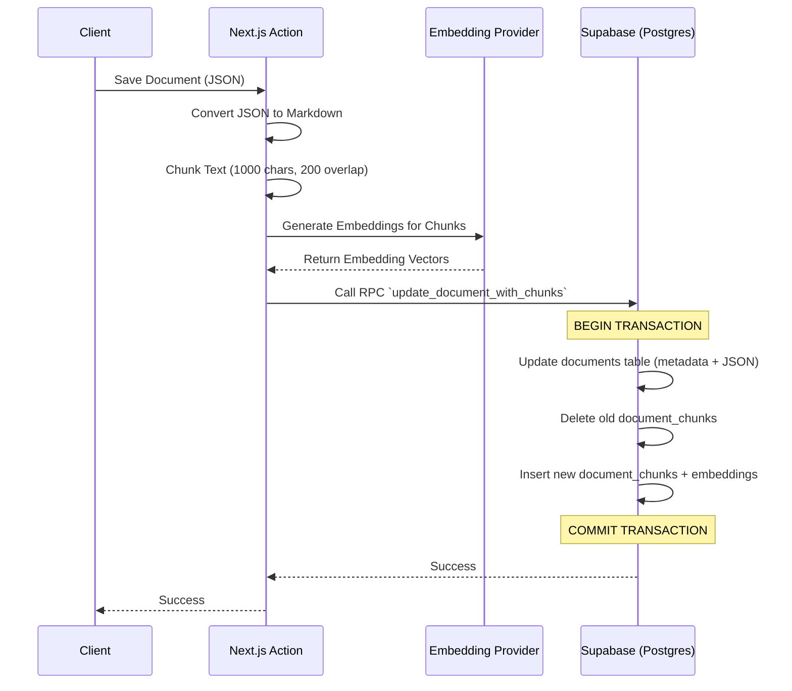

# Document Save & Retrieval Architecture

This document describes the canonical save flow for documents in Sylo, focusing on the transition to atomic JSON persistence and vector embeddings.

## 1. Data Format
Documents are persisted using a dual-column strategy to support migration and retrieval.

- **Canonical Store (`content_json`)**: Stores the document as a BlockNote JSON array. This is the source of truth for the editor.
- **Search Index (`document_chunks` table)**: Stores the document split into overlapping chunks with corresponding vector embeddings for RAG (Retrieval-Augmented Generation).
- **Legacy Store (`content`)**: Maintained for read-only fallback during migration. No longer updated during save.

## 2. Save Flow (Atomic Transaction)

To prevent inconsistency between the document content and its searchable chunks, Sylo uses a database-level transaction via a Postgres RPC.

### Flow Diagram

### Logic Details
1. **Direct Conversion**: JSON $\rightarrow$ Markdown (extracted from BlockNote blocks).
2. **Embedding Generation**: Markdown is chunked and embedded using `gemini-embedding-001` (or configured provider).
3. **Atomic Write**: The `update_document_with_chunks` RPC ensures that the document update and chunk replacement happen as a single unit of work. If the chunk insertion fails, the document metadata is not updated.

---

## 3. Production Migration Process (DONE)

The migration from legacy Markdown to canonical JSON must be performed carefully to avoid downtime or data loss.

### Phase 1: Compatibility Deployment (Read-only Fallback)
1. **Database Schema Update**: Apply migration to add `content_json` (nullable) and relax legacy `content` constraints.
2. **Application Update**:
    - **Write**: Update the editor to save exclusively to `content_json`.
    - **Read**: Implement a fallback: if `content_json` is null, import legacy `content` (Markdown) into BlockNote.
3. **Deploy**: Deploy these changes to production.

### Phase 2: Data Backfill
1. **Execution**: Run the backfill script (`npm run migrate:document-content -- --library-id [uuid]`).
2. **Process**:
    - Iterates through all documents where `content_json` is null.
    - Imports Markdown $\rightarrow$ JSON.
    - Regenerates chunks and embeddings.
    - Updates `content_json`.
3. **Verification**: Validate that `content_json` is populated for all documents.

### Phase 3: Cleanup (Final State)
1. **Remove Fallback**: Remove the legacy Markdown read logic from the application.
2. **Database Cleanup**:
    - Purge soft-deleted documents (cascades to orphaned chunks and edits).
    - Drop the legacy `content` column from the `documents` table.
    - Add a `NOT NULL` constraint to `content_json`.
3. **Deploy**: Final deployment of the clean JSON-only architecture.
