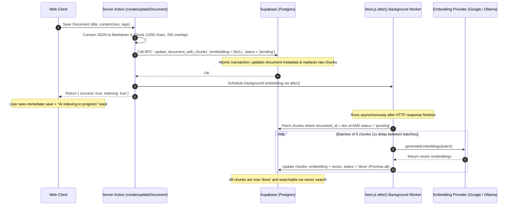

# Document Save & Retrieval Architecture

This document describes the canonical save flow for documents in Sylo, focusing on atomic persistence and the asynchronous background embedding pipeline.

## 1. Data Format
Documents are persisted using a dual-layer strategy to support rapid edits, reliable RAG retrieval, and rate-safe vector indexing.

- **Canonical Store (`content_json`)**: Stores the document as a BlockNote JSON array (`documents` table). This is the source of truth for the block editor.
- **Search Index (`document_chunks` table)**: Stores the document split into text chunks (`content`), an `embedding` (`extensions.vector`), and an `embedding_status` (`'pending' | 'done' | 'failed'`).
- **Legacy Store (`content`)**: Dropped in Phase 3 cleanup.

---

## 2. Save Flow (Decoupled & Asynchronous)

To prevent slow response times and eliminate third-party AI rate limits (e.g., Google Free Tier quota of 30,000 tokens/minute on large documents), Sylo **decouples document saving from embedding generation**.

### Sequence Diagram

### Save Pipeline Details
1. **Markdown Chunking**: The client sends BlockNote JSON. The server converts it to Markdown and splits it into text chunks (`1000` chars max with `200` chars overlap).
2. **Immediate Atomic Write**: The `update_document_with_chunks` Postgres function atomically updates document metadata and inserts chunks with `embedding_status = 'pending'` and `embedding = NULL`.
3. **Non-Blocking Return**: The server action immediately returns `{ success: true, indexing: true }` to the client. The user never waits on AI APIs.
4. **Background Indexing (`after()`)**:
   - Next.js's native `after()` schedules `processDocumentChunksInBackground(documentId)`.
   - Chunks are embedded in batches of 5.
   - A 1-second delay is introduced between batches to prevent token burst spikes.
   - Embeddings are written back concurrently using `Promise.all` and marked `'done'`.
5. **Search Query Isolation**:
   - `match_document_chunks`, `match_document_chunks_multi`, and `match_document_chunks_scoped` only match chunks where `embedding_status = 'done'`.
   - Unindexed chunks do not produce null-vector arithmetic errors. Tag and title search remain functional immediately.

---

## 3. Dedicated Background Worker API (`/api/embed-pending`)

In addition to automatic embedding via `after()`, Sylo provides a dedicated server-to-server HTTP endpoint for cron jobs and manual recovery.

- **Route**: `POST /api/embed-pending`
- **Authentication**: `Authorization: Bearer <CRON_SECRET>`
- **Behavior**: Grabs the oldest 5 pending chunks across any document, generates embeddings, writes them to the database, and returns `{ processed: count }`.
