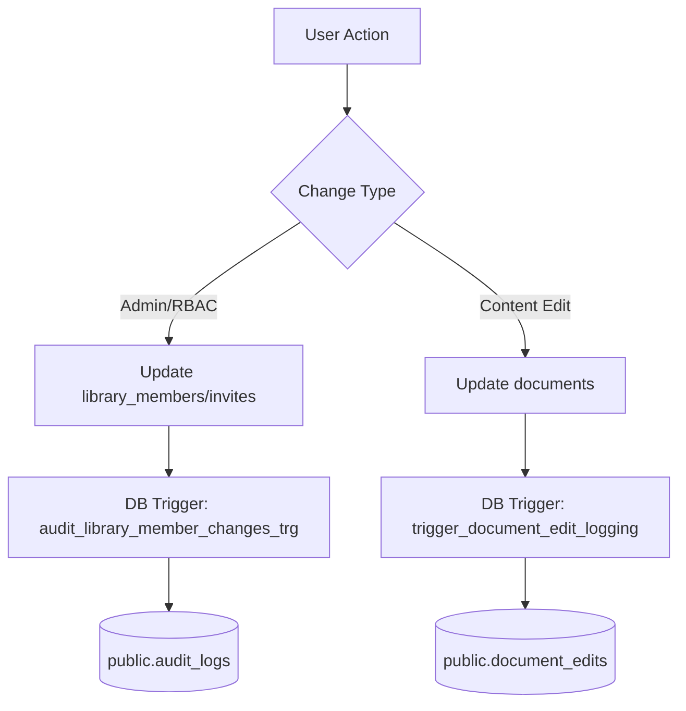

# Tracking and Auditing

This document describes the dual-layered logging architecture used in Sylo to track system administration and content changes.

## Overview

To maintain a high-integrity security record while providing detailed content history, the system splits logging into two distinct tables: `public.audit_logs` and `public.document_edits`.

### Logging Layers

| Table | Purpose | Scope | Trigger Mechanism |
| :--- | :--- | :--- | :--- |
| `public.audit_logs` | **Security & Administration** | System-level events (RBAC, memberships) | Database Triggers |
| `public.document_edits` | **Content History** | Document-level events (Create, Update, Delete) | Database Triggers |

---

## 1. Security Audit Logs (`public.audit_logs`)

The `audit_logs` table serves as the authoritative record for security-sensitive operations. 

### Tracked Events
- **Role Changes**: Changes to user roles within a library (e.g., `ROLE_CHANGED`).
- **Membership Changes**: Adding or removing users from libraries (e.g., `MEMBER_REMOVED`).
- **Invite Management**: Creation and revocation of library invite codes.

### Implementation
These logs are generated via **PostgreSQL Triggers** on the `library_members` and `library_invites` tables. This ensures that any administrative change, whether performed via the UI or directly in the database, is captured.

---

## 2. Document Edit Logs (`public.document_edits`)

The `document_edits` table tracks the lifecycle of knowledge documents.

### Tracked Events
- **CREATED**: When a new document is first inserted.
- **UPDATED**: When the title, tags, or content (`content_json`) of a document is modified.
- **DELETED**: When a document is soft-deleted (via `deleted_at`).

### Transaction Atomicity
To prevent "Ghost Edits" (where a document is changed but the log fails), these logs are implemented as **Database Triggers** on the `documents` table.

By moving the logging logic from the application layer (Server Actions) to the database layer:
1. **Atomicity**: The edit and the log occur within the same database transaction.
2. **Consistency**: If the document update succeeds, the log is guaranteed to exist.
3. **Performance**: Reduces the number of network round-trips between the Next.js server and Supabase.

---

## Summary Flow

## Maintenance Notes
- **Do not** log document-related events in `audit_logs`.
- **Do not** manually insert into `document_edits` from server actions; let the database triggers handle it to maintain atomicity.
